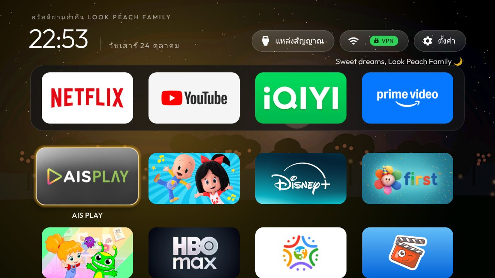
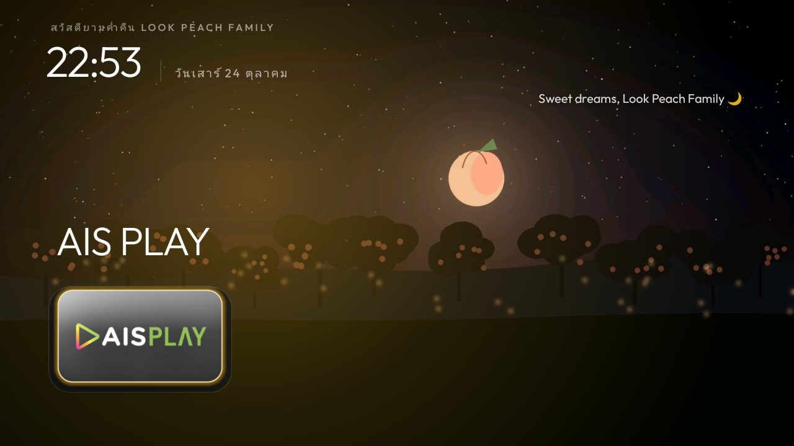
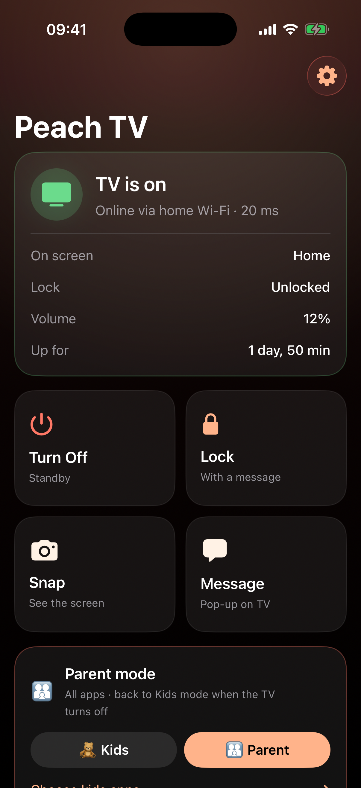

# Peach TV 🍑 — a family TV you control from your iPhone

> 🇹🇭 ต่อยอดจาก [CleanYourTV](https://github.com/Gathin23/cleanyourtv): ล้างหน้าโฮม Android TV แล้วเพิ่ม **Kid mode**,
> **Parent mode**, **ล็อกจอ / ตั้งเวลาดูทีวี** และคุมทุกอย่างจาก **iPhone** ได้ ทั้งในบ้านและนอกบ้าน (Tailscale ฝังในแอป)

> 🧑‍🏫 **อยากทำตาม?** [PROMPT.md](PROMPT.md): สอนทีละขั้น พร้อม prompt แบบ copy วางได้เลย (ล้างทีวีด้วย
> [CleanYourTV](https://github.com/Gathin23/cleanyourtv) โดย Gathin แล้วต่อด้วยโหมดเด็ก + แอป iPhone)

> 🎬 **ดูคลิปจับมือทำ:** เพจ **จับมือ AI** บน [Facebook](https://www.facebook.com/profile.php?id=61596056038143) · [YouTube @jabmueai](https://www.youtube.com/@jabmueai) · [TikTok @jabmue.ai](https://www.tiktok.com/@jabmue.ai)

| Parent mode | Kid mode |
| --- | --- |
|  |  |
| **Lock screen** | **iPhone app** |
|  |  |

Three pieces work together:

1. **A clean launcher** on the TV. This project was built on a TCL G10 (Android 12) running the
   *Look Peach Family* home screen from [CleanYourTV](https://github.com/Gathin23/cleanyourtv). The Kid mode view
   of Home (hiding the Settings/Inputs pills and the app library) is a small patch to that launcher that isn't
   published here; without it the agent still sends every app that isn't allowed back to Home.
2. **`tv-agent/`**: a 19 KB Android accessibility service with a tiny token-protected HTTP API on port 8765.
   It enforces the family rules on the TV itself, so they work even when the phone or the internet is away.
3. **`ios/`**: the SwiftUI **Peach TV** app, with [libtailscale](https://github.com/tailscale/libtailscale) built
   in so it can reach the TV from outside the home without a separate VPN app.

`promo/` holds the scripts and the [HyperFrames](https://hyperframes.heygen.com) video used to announce the
project on Facebook. [`docs/PROMPTS.md`](docs/PROMPTS.md) (ภาษาไทย, [English](docs/PROMPTS.en.md)) has every
prompt used to build the app and to make the post. Any AI coding agent works.

> **Use at your own risk.** It is a hobby project for one family TV. Read [Security](#limits-tested-on-the-tv)
> before exposing anything, and never port-forward the agent.

---

## What the app does

The **Peach TV** iPhone app checks every few seconds while it is open whether the TV is on. It can:

| Button | What happens on the TV |
| --- | --- |
| **Turn Off** | The TV goes to standby (`GLOBAL_ACTION_LOCK_SCREEN`). |
| **Wake** | Shown only while the TV is reachable but its screen is off. |
| **Lock** | A full-screen 🍑 lock with your message. The remote is blocked except volume and power. The lock stays on after a reboot. |
| **Unlock** | Removes the lock. |
| **Snap** | A screenshot of what's on the TV, which you can share or save. |
| **Message** | A peach pop-up at the top of the TV for 12 s. |
| **Today / History** | Screen time and top apps for today. Tap it for any day: when the TV went on and off, which app ran from–to (with snapshots), lock and unlock times, and per-app totals. |
| **Family rules** | TV hours and a daily screen-time limit, enforced by the TV itself. One switch turns them on or off; +15/+30/+1 h gives extra time today; the pause button pauses them until midnight. |

## Family rules, lock auto-off and snapshots (agent 1.2–1.3)

Everything runs **on the TV**, so it still works when the phone is away or the internet is down.

- **TV hours**, separate for Mon–Fri and Sat–Sun (default 07:00–20:30 / 08:00–21:00). Outside them the TV
  shows a 🌙 lock screen. Warnings pop up 5 min and 1 min before.
- **Screen time per day** (presets 30 min – 3 h, default 1 h / 2 h). Counts only while the screen is on and
  unlocked; the screensaver doesn't count. Resets at midnight.
- **Extra time**: +15/+30/+1 h from the phone adds screen time and lets the TV run that long past the end of TV hours.
- **Parent override**: Unlock in the app, or the arrow code on the remote, during a rule lock pauses the
  rules until midnight.
- **Turn the TV off 5 min after time is up** (optional).
- **Lock auto-off** (default **10 min**; choose Never/5/10/15/30 under *Edit TV hours & screen time → Lock
  screen*): any lock, yours or a rule's, left on a lit screen that long puts the TV to standby. It works even
  with the family rules off. Turning the TV back on starts the 10 minutes again. Logged as 💤 in the history.
- **History snapshots**: when an app opens (after 5 s) and every 10 min while it stays on screen, the TV saves
  a 640-px JPEG (about 10–40 KB) in `files/snaps/YYYY-MM-DD/`. Home, the lock screen and the screensaver are
  skipped, and so are all-black frames (Live TV, HDMI and DRM video like Netflix come out black). Folders
  older than **7 days are deleted automatically**, on the TV and in the phone's cache. In the app they
  appear under each app in the History timeline and in a Snapshots strip; tap one for full screen, swipe
  between them, share.

Recommended starting point (the "School-age kids 🎒" button): weekdays 07:00–20:30 and 1 h, weekends
08:00–21:00 and 2 h, TV off when time's up. Keep the last hour before bed screen-free and use +15 min as a
reward instead of raising the limit.

## Lock screen look and wording (agent 1.4–1.5)

**Family rules → Theme & wording** (also linked from the Lock sheet) changes how the TV's lock screen looks:

- **11 themes**: Peach, Night sky, Ocean, Forest, Sakura, Sunset, Space, Candy, Teddy, Dino and Mono. Each has
  its own gradient background, big picture and little background decorations.
- **Each lock screen has its own look** (agent 1.5): pick Parent lock, TV hours or Time's up at the top, then
  choose its theme, picture and decorations. **Use this look for all lock screens** copies the current one to
  the other two. The warning pop-up has no background.
- **Big picture**: the theme's own, any emoji from the row, or one you type.
- **Toggles**: background decorations, and the gentle floating animation.
- **Wording** for "outside TV hours", "screen time used up", the 5-minute and 1-minute warning, and the small
  line under a parent lock. Tap a template chip, or edit the text and use **Save as my template** (★). To
  delete a ★ template, long-press it.
  Placeholders: `{from}` `{to}` (today's TV hours), `{limit}` (today's screen time in Thai, e.g. 1 ชั่วโมง),
  `{min}` (minutes left).
- The lock and message sheets also accept your own saved templates. Swipe a line left to edit it or delete it.
- **Preview on the TV** shows the draft for 10 s, marked PREVIEW, without saving. A remote key ends it early.
  **Save** applies it straight away, including to a lock that is already showing.

Templates are kept on the iPhone. The chosen look is kept on the TV.

## Kids mode (agent 1.6)

The TV starts in **Kids mode** 🧸: the Peach home shows only the allowed apps (**AIS PLAY** by default) and
hides the Settings, Inputs and Wi-Fi pills, the app library and the tile menu. The agent sends any other app
straight back to Home with a "โหมดเด็ก" pop-up, however it was opened (tested: Disney+ and Settings bounce, AIS PLAY opens).

- **Kids / Parent** on the main screen of the app switches the mode at once. The TV's Home rebuilds within a few
  seconds when it's on screen, or the next time it's shown.
- **Choose kids apps** lists every app on the TV. Toggle the ones kids may open.
- **Back to Kids mode when the TV turns off** (on by default): Parent mode lasts until the screen goes off.
- Kids mode is not a Google kids profile. Switching profiles would stop the agent, and with it the family rules.
- The launcher reads the mode from the agent's read-only provider `content://com.lookpeach.tvagent.kids/state`
  (`KidsMode.java` in the launcher patch, not published here). Without agent 1.6, Home shows everything as before.

## Sharing the app with family (TestFlight)

1. Once only: in App Store Connect, go to Apps → + → New App. Choose iOS, a unique name (e.g. "Peach TV Family"),
   the bundle ID from `ios/project.yml` (change `com.example.PeachRemote` and set
   `DEVELOPMENT_TEAM` to your Apple Team ID first) and SKU `peachremote`.
2. `ios/scripts/upload-testflight.sh` archives the app, signs it for distribution and uploads it. It uses the
   App Store Connect API key in `~/.appstoreconnect/private_keys`; set `ASC_KEY_ID` and `ASC_ISSUER_ID`.
3. `python3 ios/scripts/testflight_invite.py --build <number> --email x@y.com [--first Name]` waits for Apple
   to process that build (the upload script prints the number). It then fills in the test information, adds the build and the tester to the external "Family" group
   and submits the build for Beta App Review. It also needs `BUNDLE_ID` and your review contact in
   `CONTACT_FIRST`, `CONTACT_LAST`, `CONTACT_EMAIL` and `CONTACT_PHONE`. The script needs
   `pip install pyjwt cryptography requests`, and a venv is fine.
4. Apple's first review usually takes under a day. The tester then gets an email invite and installs the app
   with the TestFlight app.

The app comes already paired with the TV, because the token is built in. To use it away from home, send her an
invite (next section). Builds expire after 90 days, so re-run steps 2–3 to update.

## Away from home (built-in Tailscale)

The app has Tailscale built in ([TailscaleKit](https://github.com/tailscale/libtailscale), userspace, no VPN
profile). Each iPhone becomes a small node on the family tailnet while the app is open. The Tailscale app isn't
needed.

- **Route:** calls try the home Wi-Fi first, then the TV's tailnet address through the built-in node. The
  status line says "via built-in Tailscale". The node stops when the app goes to the background.
- **Node state:** stays in Application Support/tailscale, so an iPhone joins only once. The node is tagged and
  never expires.

### One-time setup (Tailscale admin console)

1. **Access controls:** add the tags and a rule that lets phones reach only the agent port. Keep your own rules.

   ```jsonc
   "tagOwners": {
     "tag:peachtv":    ["autogroup:admin"],
     "tag:peachphone": ["autogroup:admin"],
   },
   "grants": [
     // ...your existing rules...
     {"src": ["tag:peachphone"], "dst": ["tag:peachtv"], "ip": ["tcp:8765"]},
   ],
   ```

   With the legacy `acls` syntax, add `{"action": "accept", "src": ["tag:peachphone"], "dst": ["tag:peachtv:8765"]}`.
2. **Tag the TV:** Machines → the TV → ⋯ → Edit ACL tags → `tag:peachtv`. Its 100.x address stays the same.
   Make sure your own rules still let your Mac reach `tag:peachtv` (the default allow-all policy does) for ADB.
3. **Create the key:** Settings → Keys → Generate auth key. Choose Reusable, Pre-approved, Tags →
   `tag:peachphone`, and expiry up to 90 days. The key only matters for new joins.
4. **Add it to the app:** Settings → Away from home → paste the key into "Invite key". Tap
   "Set up on this iPhone".

### Inviting family

Settings → Away from home → Invite family 💌 shows a QR code and a "Send the invite link" button.
- **The link:** `peachtv://join?k=<auth key>&t=<agent token>&ts=<TV tailnet IP>&lan=<TV LAN IP>&p=8765`.
- **On her iPhone:** with the app installed from TestFlight, she scans the QR code with the Camera app, or taps
  the link (LINE, iMessage) and taps Join. That pairs the TV and joins the tailnet in one step. Pasting a copied
  link in Settings → Away from home works too.
- **Treat the link like a house key:** it gives control of this TV and nothing else on the tailnet.

### Revoking

- **One phone:** delete its `peach-iphone-xxxx` machine in the admin console. On the phone, Settings → Away
  from home → Remove only clears the local state.
- **Old links:** revoke the auth key to stop them working, and make a new key for future invites.

### Rebuilding the framework

`ios/Frameworks/` is gitignored. `ios/scripts/build-tailscalekit.sh` rebuilds `TailscaleKit.xcframework` from
the pinned libtailscale commit; it needs Go and Xcode. The framework adds about 20 MB to the app.

## How it works

```
iPhone (Peach TV app)  ──HTTP + token──▶  TV agent :8765 (com.lookpeach.tvagent)
     │ Tailscale 100.x.y.z first          an accessibility service that runs
     └ home Wi-Fi 192.168.1.50 fallback       a tiny API (no Play services, 19 KB)
```

- `tv-agent/` is the Android agent.
  - It answers only loopback, private LAN and Tailscale (100.64.0.0/10) addresses. Every request needs
    `Authorization: Bearer <token>`.
  - Android restarts it at boot because it is an accessibility service.
- `ios/` is the SwiftUI app: iOS 17, iPhone only.
  - It tries the host that last answered first.
  - The token is stored in the Keychain.

## Install / update

```bash
# TV agent: needs network ADB on the TV and a CleanYourTV checkout next to this repo
# (git clone https://github.com/Gathin23/cleanyourtv ../cleanyourtv, or set CLEANTV=<path>).
# Prints and saves the pairing to tv-agent/.pairing.json
cd tv-agent && TV_HOST=192.168.1.50 ./install.sh

# iPhone app (iPhone connected or paired over Wi-Fi in Xcode)
cd ios && LAN_HOST=192.168.1.50 TS_HOST=100.x.y.z ./build-and-install.sh            # or DEVICE=<id from: xcrun devicectl list devices>
```

`ios/scripts/gen-pairing.sh` writes the token into a gitignored Swift file, so a fresh build is
already paired. You can change the hosts or token later in the app under **Settings** (gear icon).

- On first launch, allow **Local Network** access.
- Away from home, the built-in Tailscale reaches the TV (see above); the Tailscale VPN app works too.

## Unlocking without the phone

While the lock screen is up, press the **unlock code** on the TV remote's arrows. The app shows it
under **Settings**.

Read the code:

```bash
adb -s 192.168.1.50:5555 shell \
  am broadcast -a com.lookpeach.tvagent.GET -n com.lookpeach.tvagent/.ConfigReceiver
```

Change the token or code (then re-run `ios/build-and-install.sh`, or edit the token in the app):

```bash
adb -s 192.168.1.50:5555 shell am broadcast -a com.lookpeach.tvagent.SET -n com.lookpeach.tvagent/.ConfigReceiver --es token NEW_32_CHARS --es unlock_code UDLRUD
```

Last resort: run `adb uninstall com.lookpeach.tvagent`. This removes the lock and the agent.

## API (for scripts)

```bash
T=$(python3 -c "import json;print(json.load(open('tv-agent/.pairing.json'))['token'])")
curl -H "Authorization: Bearer $T" http://100.x.y.z:8765/status
curl -H "Authorization: Bearer $T" -X POST -d '{"message":"ไปทำการบ้านก่อนนะ"}' http://100.x.y.z:8765/lock
```

| Route | Notes |
| --- | --- |
| `GET /status` | Returns screenOn, locked, lockReason (parent/schedule/limit), lockMessage, rulesOn, kidsMode, usedSec, remainingSec, app/appLabel, volume, muted, uptimeSec, model, android, agent. |
| `POST /sleep`, `POST /wake` | `/wake` only works while the TV is still on the network. |
| `POST /lock {"message"}`, `POST /unlock` | |
| `POST /message {"text"}` | |
| `GET /screenshot` | JPEG, up to 1280 px wide. Returns 409 while the screen is off. |
| `GET /activity?date=YYYY-MM-DD` | One day (TV local time, default today): `sessions` (TV on), `apps` (from–to), `totals`, `marks` (lock, unlock, schedule, limit, allowed, lockoff), `days` (days with history). |
| `GET /rules`, `POST /rules {...}` | `{"enabled","turnOff","lockOffMin","schedule":{"enabled","weekdayFrom","weekdayTo","weekendFrom","weekendTo"},"limit":{"enabled","weekdayMin","weekendMin"}}`. Times are minutes after midnight; send only the fields to change. Replies with `rules` and `today` (usedSec, limitSec, bonusSec, remainingSec, paused, blocked). |
| `POST /bonus {"minutes":15}` | Extra time today (1–240). |
| `POST /pause {"today":true}` | Pause the rules until midnight (`false` resumes). |
| `GET /snaps?date=YYYY-MM-DD` | That day's snapshots: `time`, `app`, `label`, `name`; `days` lists the days kept. |
| `GET /snap?date=...&name=...` | One snapshot JPEG. |
| `GET /look`, `POST /look {...}` | Lock screen look. `styles` holds `parent`, `schedule` and `limit`, each with `theme`, `emoji` (empty = the theme's own), `sprinkle`, `animate`; the same fields at the top level set all three at once. Also `parentSub`, `scheduleText`, `limitText`, `warnText`. Send only the fields to change; `themes` lists the theme ids. |
| `POST /look/preview {..., "kind":"schedule"}` | Shows a draft look for 10 s without saving. `kind`: `parent`, `schedule`, `limit` or `warn`. |
| `GET /kids`, `POST /kids {"enabled","apps","auto"}` | Kids mode. `apps` are the allowed package names; `auto` puts Kids mode back when the screen turns off. Replies with `enabled`, `auto`, `apps` and `available` (`pkg`, `label` of every app on the TV). Send only the fields to change. |
| `GET /config` | Returns the unlock code. |

Errors come back as `{"ok":false,"error":"..."}`: 401 for a wrong token, 403 for a non-private source address.

## Limits (tested on the TV)

- **History:**
  - The TV writes `files/activity/YYYY-MM-DD.tsv` and keeps 60 days.
  - History starts on the day the agent (v1.1) was installed.
  - If the power is cut instead of using standby, "off" is the last heartbeat (within 1 minute).
  - Only real apps are logged; dialogs and the keyboard are skipped.
  - The phone keeps a copy of each day it has viewed, so it still shows while the TV is off.

- **Rules and snapshots:** the clock and the day boundary use the TV's own time zone. Lock auto-off was
  tested live (set to 1 min, the TV went to standby after 64 s; the timer ticks every 20 s). The first
  snapshot on app open was tested live; the 10-minute repeat and the daily limit lock share the same tick
  and were not waited out on the TV.
- **Turning the TV on remotely isn't possible.**
  - In standby the TV stays reachable for about 10 s, then leaves the network.
  - TCL's *network standby* (`tcl_sys_network_standby_enabled`) is `0`, and a Wake-on-LAN packet did nothing.
  - So after **Turn Off**, someone needs the remote to turn it back on. The app shows "TV is off · last seen …".
- **App name on screen:** right after the agent (re)starts, the app name shows "Home" until the next app switch.
- **Snapshots:** HDMI, Live TV and DRM apps (Netflix) may come out black. That is the TV protecting video, not a bug.
- **How the lock blocks keys:** the lock window takes key focus and swallows every key except volume and
  power. The Home button opens Home *underneath* it.
  - The accessibility key filter is only a second line of defence.
  - ADB-injected keys (`input keyevent`) never pass through accessibility filters, so the lock was tested through the focused window.
- **Security:**
  - Port 8765 is plain HTTP.
  - Use it only on the home Wi-Fi or through Tailscale (WireGuard). Never port-forward it on the router.
  - Treat the token like a password.

## License

MIT. See [LICENSE](LICENSE). The CleanYourTV launcher is © its authors under its own MIT license, and
libtailscale is © Tailscale Inc. under BSD-3-Clause.
